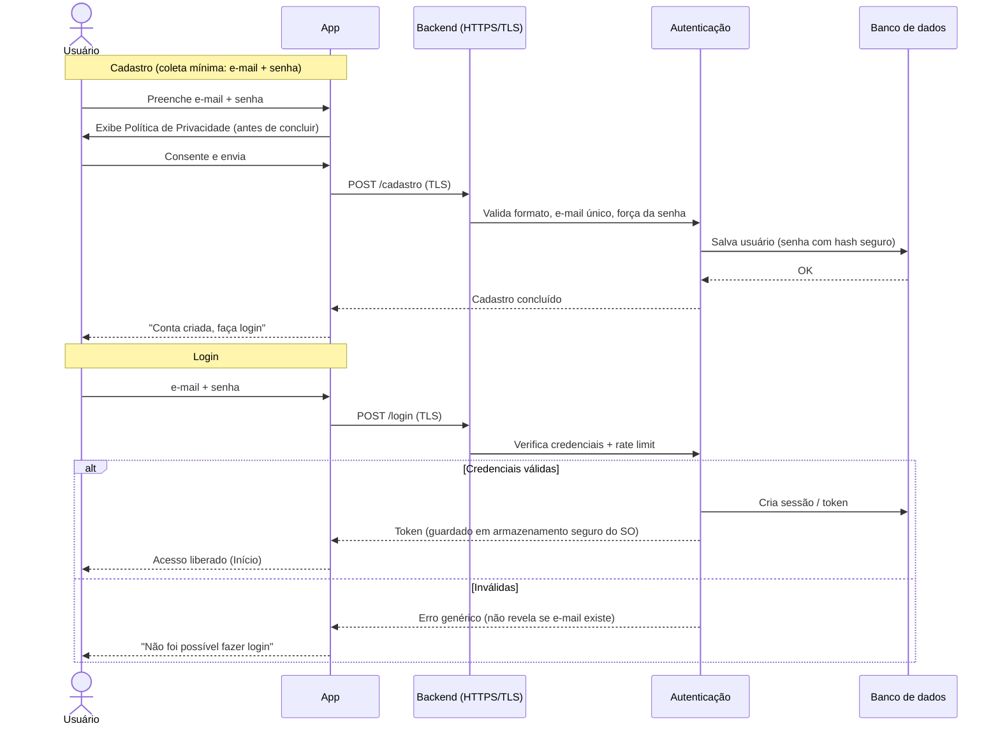
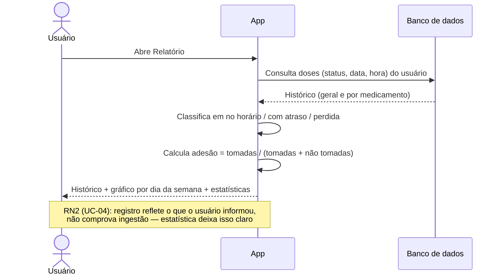

# Vídia — Diagramas de sequência

## 1. Autenticação (cadastro + login)



## 2. UC-02 — Cadastro por leitura de receita (IA)

```mermaid
sequenceDiagram
    actor U as Usuário
    participant App
    participant IA as Serviço de IA (LLM)
    participant DB as Banco de dados
    participant D as Dispenser

    U->>App: "Ler receita"
    App->>U: Aviso: IA pode errar, conferência é sua responsabilidade
    U->>App: Aceita (consentimento específico p/ IA no 1º uso)
    U->>App: Fotografa a receita (orientação por voz)
    App->>App: Verifica qualidade (foco, luz, corte)
    alt Imagem ruim (A1)
        App-->>U: Pede nova foto
    end
    App->>IA: Envia imagem (TLS)
    alt IA indisponível/timeout/sem internet (E1/E4)
        IA-->>App: Falha
        App-->>U: Oferece cadastro manual (UC-01)
    else Resposta OK
        IA-->>App: nome, dosagem, intervalo, duração + confiança por campo
        App->>App: Valida (regras UC-01); marca campos ausentes / baixa confiança
        App-->>U: Mostra rascunho para revisão
        U->>App: Corrige e confirma cada medicamento (RN1: nunca salva sem confirmação)
        App->>DB: Salva medicamento + gera doses + grava auditoria (imagem, resposta bruta, valores)
        App->>D: Envia cronograma (UC-05)
        App-->>U: Medicamento cadastrado
    end
```

## 3. UC-03 + UC-04 — Alerta da dose e registro da resposta

```mermaid
sequenceDiagram
    actor U as Usuário
    participant D as Dispenser
    participant App
    participant DB as Banco de dados

    Note over D,App: No horário (não depende de internet - RN1)
    D->>U: Alarme sonoro + luminoso (cronograma local)
    App->>U: Notificação local (som + vibração + texto)

    loop A cada N min, até fim da janela de tolerância
        D->>U: Repete alarme
        App->>U: Repete notificação
    end

    alt Usuário responde (UC-04)
        U->>D: Aperta "Tomei" / "Adiar" / "Não tomei"
        D->>App: Evento (data, hora, origem=dispenser)
        App->>App: Classifica status (no horário / atraso)
        App->>D: Interrompe alarme nos 2 canais
        App->>DB: Registra dose + atualiza agenda/histórico/estatísticas
        Note over App,DB: E1 duplo registro app x dispenser -> vale o 1º;<br/>se conflitante, usuário decide
    else Dispenser sem conexão (A4 / UC-05)
        D->>D: Guarda evento com data e hora
        App-->>U: "Aguardando sincronização"
        D->>App: Sincroniza quando reconecta
    else Sem resposta até fim da janela
        App->>DB: Dose = PERDIDA
    end
```

## 4. Geração de relatório / estatísticas


