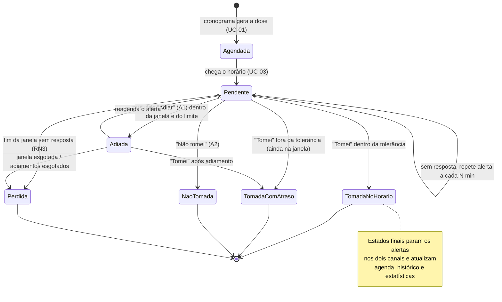
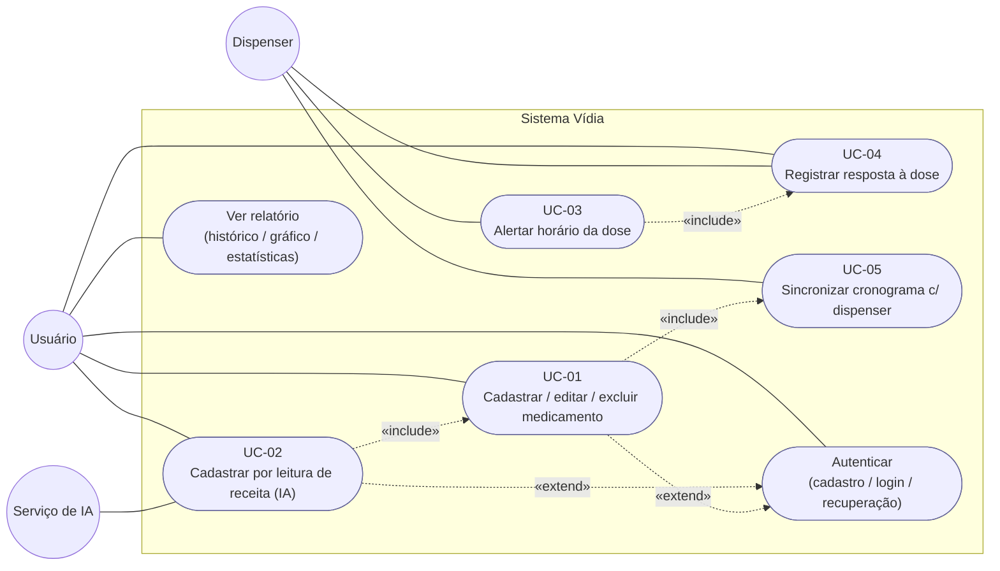

# Vídia — Diagrama de estados e casos de uso

## 1. Diagrama de estados da dose

Representa o ciclo de vida de **uma dose** desde que é gerada pelo cronograma até seu status final. Reflete UC-03/UC-04 e a regra RN1 ("cada dose tem exatamente um status final").

## 2. Diagrama de casos de uso (ator × UC)

Mostra os atores do sistema e os casos de uso documentados, com as relações `include`/`extend`.

> Observação: `UC-05` é referenciado na documentação (pós-condição de UC-01 e fluxos de UC-03/UC-04), mas não tem fluxo próprio detalhado; aqui é representado pelas relações de `include`/sincronização.
