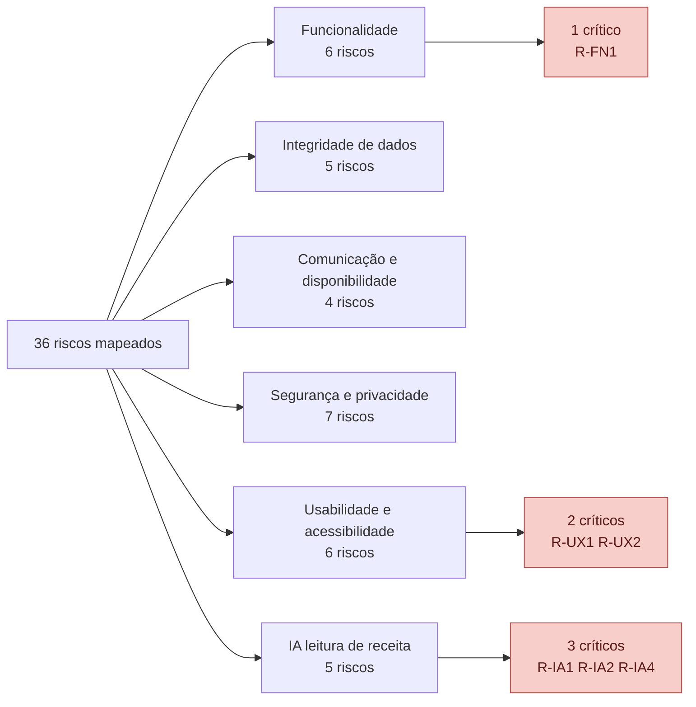
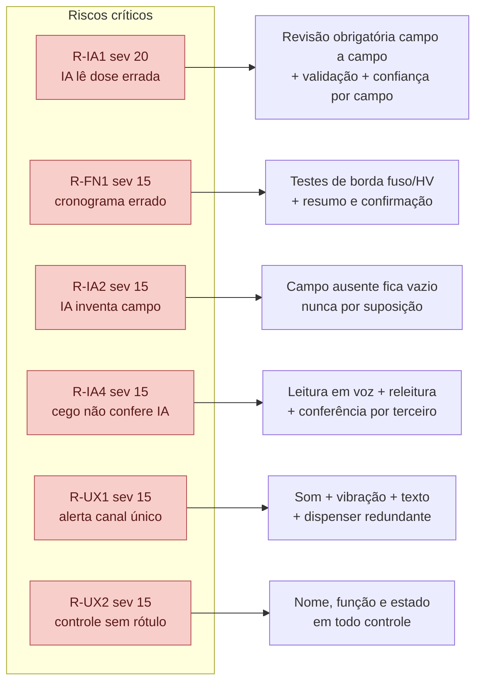
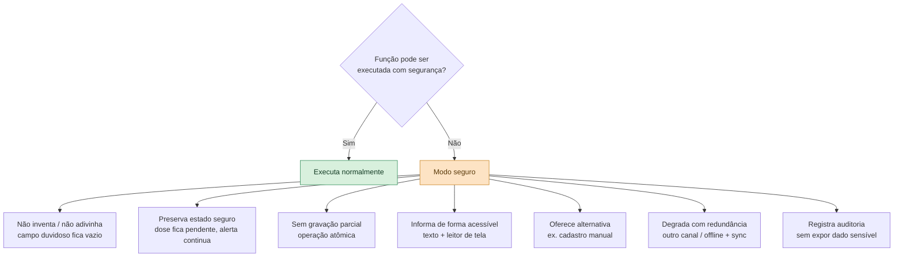
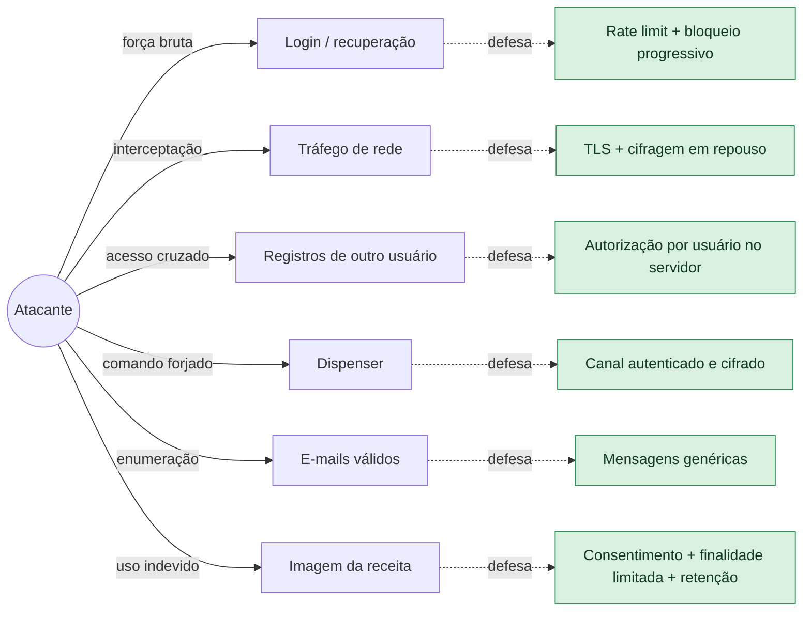

# Vídia — Riscos em formato visual (guia da equipe)

Resumo visual da [análise de riscos](06-analise-de-riscos.md). Diagramas em Mermaid (renderizam no GitHub).

## 1. Mapa de calor — Probabilidade × Gravidade

Linhas = Probabilidade (P), colunas = Gravidade (G). Cada célula mostra a severidade (P×G) e os riscos naquela posição. Canto inferior direito = maior prioridade.

Legenda: 🟥 Crítico (≥15) · 🟧 Alto (10–14) · 🟨 Médio (5–9) · 🟩 Baixo (≤4)

| P \ G | G=2 | G=3 | G=4 | G=5 |
|-------|-----|-----|-----|-----|
| **P=4** | 🟨 8 | 🟧 12 · R-DAT1 | 🟧 16 | 🟥 20 · **R-IA1** |
| **P=3** | 🟨 6 · R-COM3 R-SEC7 R-UX6 | 🟨 9 · R-FN3 R-FN6 R-DAT5 R-COM2 R-UX4 | 🟧 12 · R-FN2 R-DAT2 R-DAT4 R-SEC3 R-UX3 | 🟥 15 · **R-FN1 R-IA2 R-IA4 R-UX1 R-UX2** |
| **P=2** | 🟩 4 | 🟨 6 · R-FN5 R-IA5 | 🟨 8 · R-DAT3 R-SEC4 R-SEC5 R-SEC6 R-UX5 R-COM4 | 🟧 10 · R-FN4 R-COM1 R-SEC1 R-SEC2 R-IA3 |

> Leitura rápida: tudo na coluna **G=5** merece atenção porque é saúde; a célula **P=4, G=5** (R-IA1) é o risco número 1.

## 2. Distribuição dos riscos por categoria

## 3. Top 6 riscos críticos → controle principal

## 4. Comportamento seguro quando não dá para executar com segurança

## 5. Superfícies de ataque e defesas (segurança)

