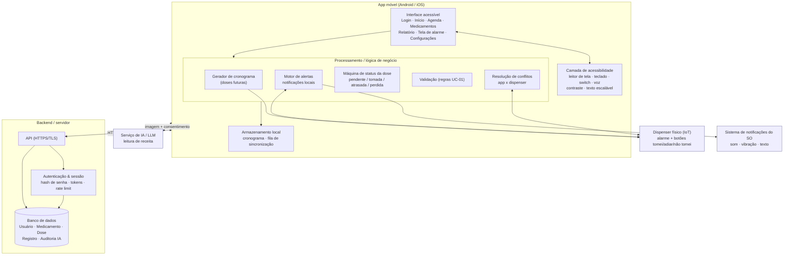
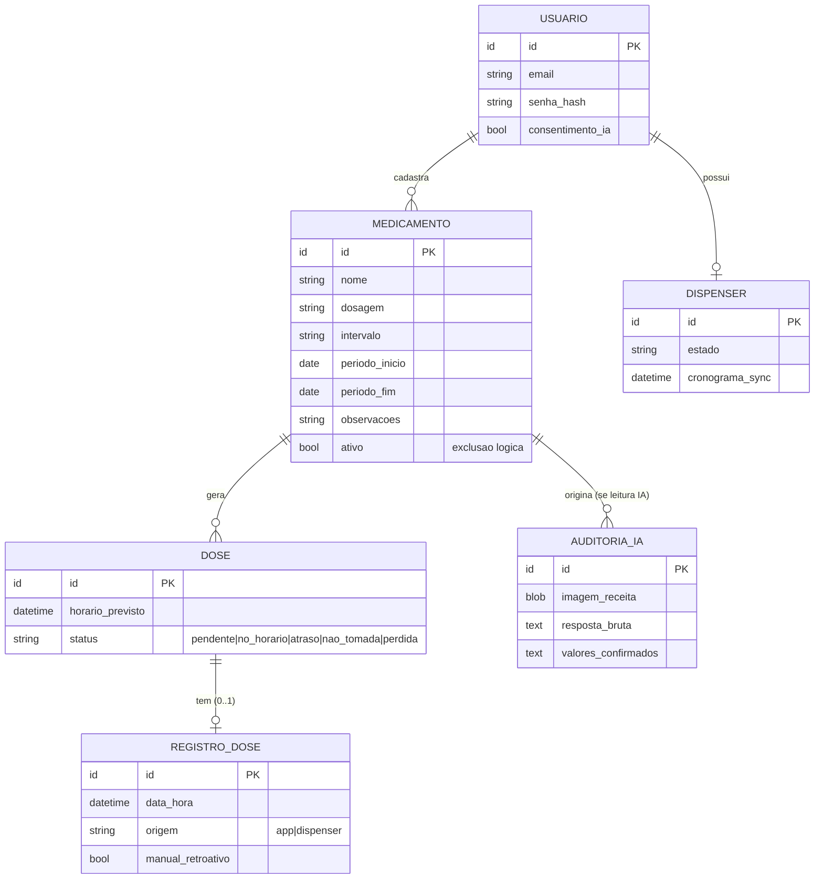
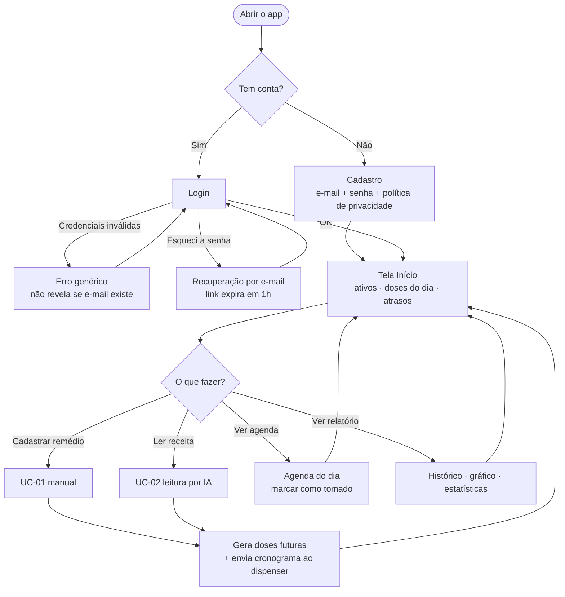
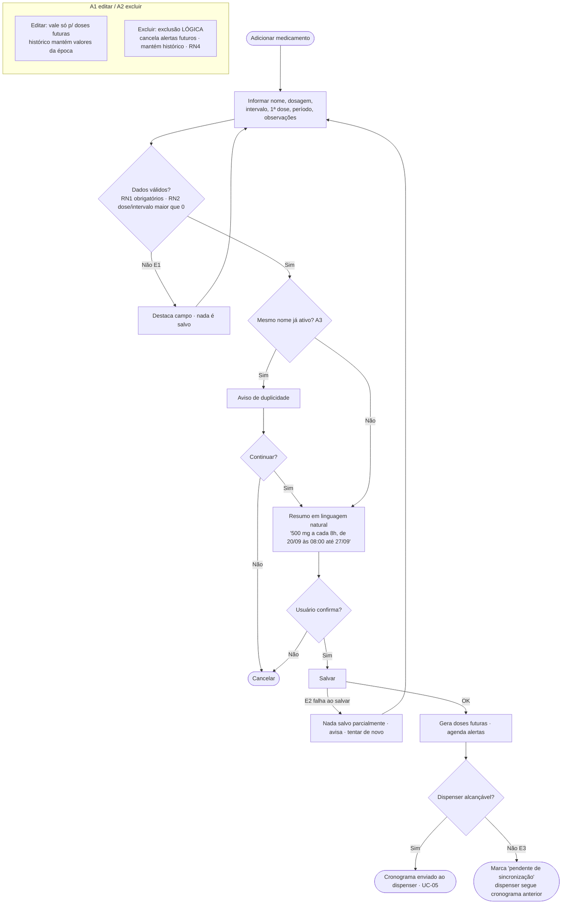
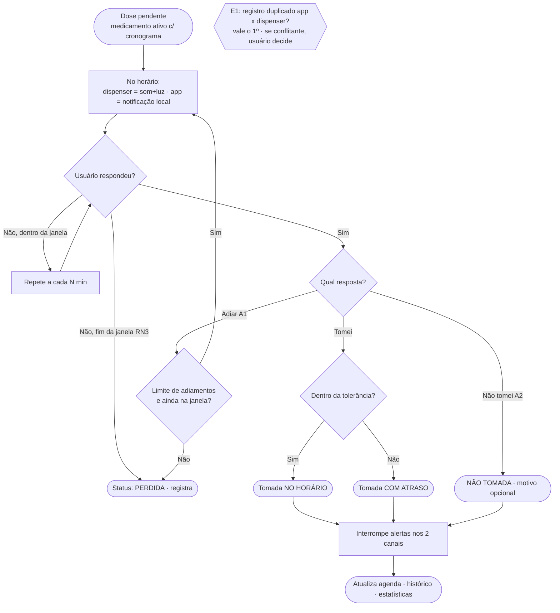
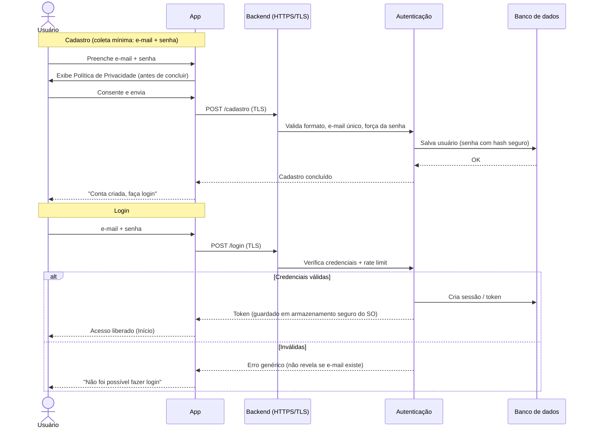
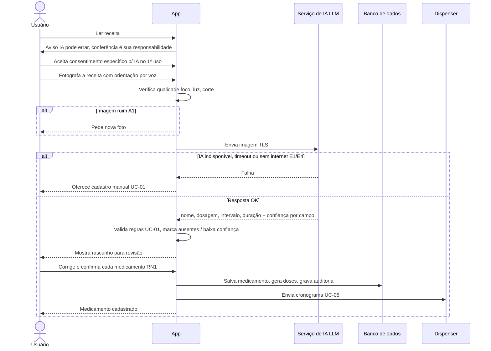
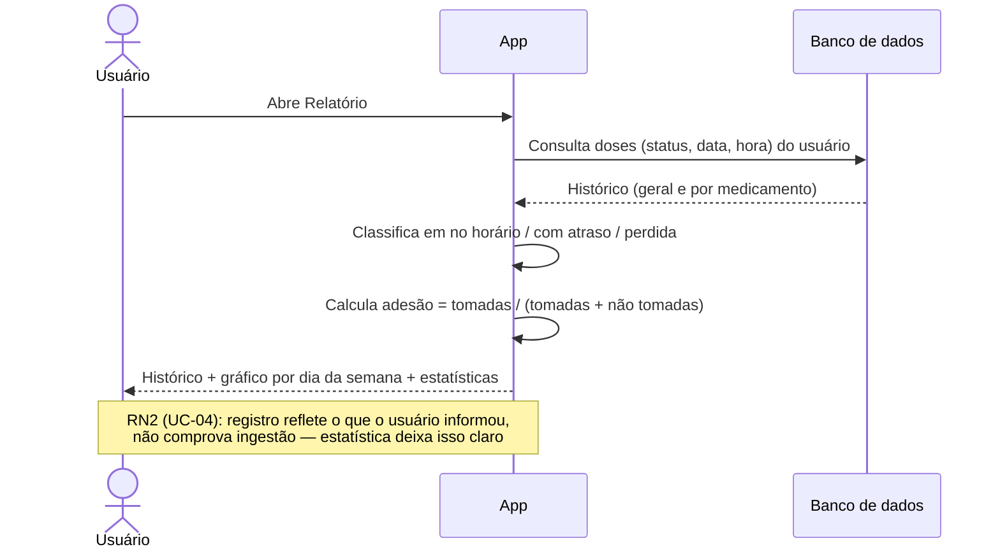
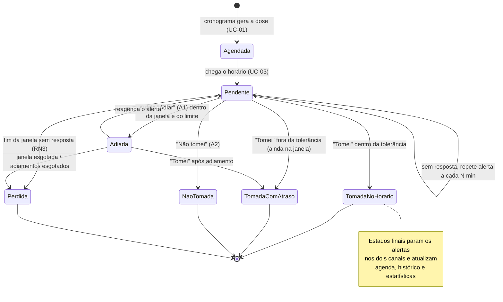
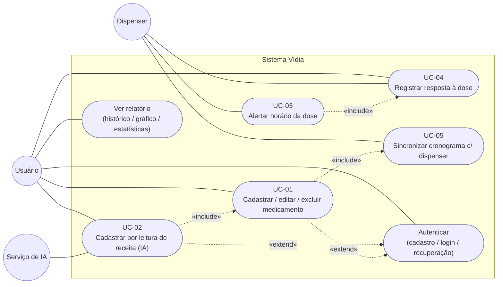

# Vídia — Análise e modelagem do produto

> Documento único consolidado. App de gestão de medicamentos com foco em **acessibilidade** (WCAG 2.2 / Android / Apple HIG), **leitura de receita por IA** e integração com um **dispenser físico**.
>
> Os diagramas usam **Mermaid** — renderizam automaticamente no GitHub e em https://mermaid.live.

## Sumário

- [Parte 1 — Compreender o funcionamento (funcionalidades e componentes)](#parte-1--compreender-o-funcionamento-funcionalidades-e-componentes)
  - [1. Visão geral](#1-visão-geral)
  - [2. Mapa de funcionalidades (por épico)](#2-mapa-de-funcionalidades-por-épico)
  - [3. Componentes do sistema](#3-componentes-do-sistema)
  - [4. Fluxos principais (casos de uso)](#4-fluxos-principais-casos-de-uso)
  - [5. Observações de risco](#5-observações-de-risco)
- [Parte 2 — Representação visual do fluxo de operação](#parte-2--representação-visual-do-fluxo-de-operação)
  - [A. Arquitetura de componentes](#a-arquitetura-de-componentes)
  - [B. Modelo de dados (entidades)](#b-modelo-de-dados-entidades)
  - [C. Fluxograma — fluxo geral do usuário](#c-fluxograma--fluxo-geral-do-usuário)
  - [D. Fluxograma — UC-01 cadastrar/editar/excluir](#d-fluxograma--uc-01-cadastrareditarexcluir)
  - [E. Fluxograma — UC-03/04 alerta e resposta à dose](#e-fluxograma--uc-0304-alerta-e-resposta-à-dose)
  - [F. Sequência — Autenticação](#f-sequência--autenticação)
  - [G. Sequência — UC-02 leitura de receita por IA](#g-sequência--uc-02-leitura-de-receita-por-ia)
  - [H. Sequência — UC-03/04 alerta e registro da dose](#h-sequência--uc-0304-alerta-e-registro-da-dose)
  - [I. Sequência — Relatório / estatísticas](#i-sequência--relatório--estatísticas)
  - [J. Estados — ciclo de vida da dose](#j-estados--ciclo-de-vida-da-dose)
  - [K. Casos de uso (ator × UC)](#k-casos-de-uso-ator--uc)

---

# Parte 1 — Compreender o funcionamento (funcionalidades e componentes)

## 1. Visão geral

O Vídia ajuda o usuário a **não perder doses de medicamentos**. Ele:

- cadastra remédios (manualmente ou lendo a receita com IA),
- gera um cronograma de doses,
- avisa na hora certa por **vários canais** (som, vibração, notificação em texto e um dispenser físico),
- registra o que foi tomado / adiado / não tomado / perdido,
- mostra histórico, gráficos e estatísticas de adesão ao tratamento.

Tudo isso sob duas restrições fortes que atravessam o produto inteiro:

- **Acessibilidade** (Épico 1): o app precisa ser 100% operável por leitor de tela, teclado, switch, voz, com contraste, texto ampliável etc.
- **Privacidade/LGPD**: dados de medicamento e imagem de receita são **dados pessoais sensíveis** (saúde), com coleta mínima, consentimento específico e comunicação protegida.

## 2. Mapa de funcionalidades (por épico)

| Épico | Funcionalidade | Resumo |
|-------|----------------|--------|
| 1. Design acessível | Acessibilidade transversal | Contraste, texto escalável, leitor de tela, alarme multicanal, alvos de toque grandes, operação sem toque, prevenção de erro, verificação (CA01–CA32) |
| 2. Autenticação | Cadastro, login, recuperação de senha | E-mail + senha, hash seguro, HTTPS/TLS, sessão segura, política de privacidade, proteção contra força bruta, recuperação por e-mail (link expira em 1h) |
| 3. Início | Acompanhamento + Agenda | Caixas de visão geral (ativos, doses do dia, atrasos), lista de doses por horário com status, "Marcar como tomado", notificações |
| 4. Medicamentos | Adicionar/editar/excluir + Leitura de receita (IA) | CRUD lógico com histórico, IA que lê receita e devolve texto para revisão, consentimento específico para o uso de IA |
| 5. Relatório | Histórico, gráfico, estatísticas | Histórico geral e por medicamento, status das doses, gráfico por dia da semana, adesão geral |
| 6. Dispositivos | Dispenser físico | Alarme no dispenser, botões físicos (tomei/adiar/não tomei), comunicação segura, sincronização |

## 3. Componentes do sistema

### 3.1 Interface (app móvel — Android e iOS)
- Telas: **Login/Cadastro/Recuperação**, **Início** (dashboard), **Agenda**, **Medicamentos** (CRUD + leitura de receita), **Relatório** (histórico/gráfico/estatísticas), **Tela de alarme**, **Configurações** (canais de alerta, volume, soneca).
- Requisitos de acessibilidade embutidos em cada controle: nome/função/estado expostos (CA12), alvos ≥ 48dp/44pt (CA21), alternativa de toque único a gestos (CA22), foco visível (CA25), sem limite de tempo oculto (CA28).

### 3.2 Processamento (lógica de negócio)
- **Gerador de cronograma**: a partir de dose, intervalo, data/hora da primeira dose e período, gera as doses futuras (UC-01).
- **Motor de alertas**: agenda notificações locais no aparelho (não depende de internet — UC-03 RN1) e dispara o dispenser.
- **Máquina de status da dose**: `pendente → tomada no horário | tomada com atraso | não tomada | perdida` (UC-03/UC-04, RN1 "cada dose tem exatamente um status final").
- **Janela de tolerância / soneca**: define quando a dose vira "perdida" e limita adiamentos.
- **Resolução de conflitos**: dedup entre registro do app e do dispenser (UC-04 E1).
- **Validação**: regras de negócio do cadastro (dose/intervalo > 0, campos obrigatórios — UC-01 RN1/RN2).

### 3.3 Banco de dados
- Entidades principais: **Usuário**, **Medicamento** (com histórico — exclusão é lógica, RN4), **Dose** (agendada e seus status), **Registro de dose** (origem app/dispenser, data/hora, manual/retroativo), **Dispenser** (vínculo, cronograma, estado), **Auditoria de IA** (imagem da receita + resposta bruta + valores confirmados — UC-02 passo 8).
- Dados de saúde tratados como **sensíveis**: armazenamento e transmissão protegidos (Épico 4 CA03).

### 3.4 Autenticação e segurança
- E-mail + senha; **hash** seguro da senha (CA03), nunca texto puro.
- **HTTPS/TLS** em toda comunicação (CA05/CA11).
- **Sessão** segura; tokens persistentes em armazenamento seguro do SO (CA10); logout invalida token (CA14).
- **Mensagem de erro genérica** no login (não revela se o e-mail existe — CA09).
- **Proteção contra tentativas repetidas** (CA13) e recuperação de senha com link que **expira em 1h**, enviado só se o e-mail existir (CA16).
- Controle de acesso por usuário aos próprios registros (CA12).

### 3.5 Notificações / alertas (multicanal)
- Todo lembrete combina **som + vibração + notificação em texto** e o usuário escolhe os canais (CA18). Som nunca é o único aviso.
- Notificação local no horário (CA01) e **renotificação de atraso** (CA02).
- Privacidade na tela bloqueada: não expor dado de saúde sem opt-in (Módulo Início CA06).
- Tela de alarme sempre com botões "Parar" e "Adiar" visíveis; volume ajustável (CA19).

### 3.6 Integrações externas
- **Serviço de IA (LLM)**: lê a imagem da receita e devolve os dados do medicamento em texto acessível, com nível de confiança por campo (UC-02). Requer internet; consentimento específico (Épico 4 CA07); nunca cria/altera medicamento sem confirmação do usuário (RN1).
- **Dispenser físico (IoT)**: alarme sonoro/luminoso a partir do cronograma armazenado localmente, botões físicos (tomei/adiar/não tomei), **comunicação protegida** (Épico 6 CA03), sincronização quando reconecta.

## 4. Fluxos principais (casos de uso)

- **UC-01** Cadastrar/editar/excluir medicamento → valida, mostra resumo em linguagem natural, salva, gera doses futuras, envia cronograma ao dispenser (UC-05).
- **UC-02** Cadastrar por leitura de receita (IA) → aviso de responsabilidade, foto, IA extrai campos, usuário revisa/confirma, segue UC-01, grava auditoria.
- **UC-03** Alertar horário da dose → dispenser + app alertam, repetem até fim da janela, dose vira "perdida" se não houver resposta.
- **UC-04** Registrar resposta à dose → "Tomei"/"Adiar"/"Não tomei" (app ou dispenser), classifica status, para alertas, atualiza agenda/histórico/estatísticas.
- **UC-05** (referenciado) Sincronizar cronograma com o dispenser.

## 5. Observações de risco

- Erro de digitação ou leitura de dose (ex.: "5 mg" lido como "50 mg") — mitigado por revisão obrigatória e auditoria.
- Edição/exclusão que não chega ao dispenser — marcada como "pendente de sincronização".
- Dose duplicada por registros conflitantes (app + dispenser) — resolução por "vale o primeiro registro".
- Vazamento de dado de saúde — mitigado por LGPD, TLS, consentimento.

---

# Parte 2 — Representação visual do fluxo de operação

## A. Arquitetura de componentes



## B. Modelo de dados (entidades)



## C. Fluxograma — fluxo geral do usuário



## D. Fluxograma — UC-01 cadastrar/editar/excluir



## E. Fluxograma — UC-03/04 alerta e resposta à dose



## F. Sequência — Autenticação



## G. Sequência — UC-02 leitura de receita por IA



## H. Sequência — UC-03/04 alerta e registro da dose

```mermaid
sequenceDiagram
    actor U as Usuário
    participant D as Dispenser
    participant App
    participant DB as Banco de dados

    Note over D,App: No horário, não depende de internet RN1
    D->>U: Alarme sonoro + luminoso, cronograma local
    App->>U: Notificação local som + vibração + texto

    loop A cada N min, até fim da janela de tolerância
        D->>U: Repete alarme
        App->>U: Repete notificação
    end

    alt Usuário responde UC-04
        U->>D: Aperta Tomei / Adiar / Não tomei
        D->>App: Evento data, hora, origem dispenser
        App->>App: Classifica status no horário / atraso
        App->>D: Interrompe alarme nos 2 canais
        App->>DB: Registra dose, atualiza agenda, histórico, estatísticas
        Note over App,DB: E1 duplo registro, vale o 1º;<br/>se conflitante, usuário decide
    else Dispenser sem conexão A4 / UC-05
        D->>D: Guarda evento com data e hora
        App-->>U: Aguardando sincronização
        D->>App: Sincroniza quando reconecta
    else Sem resposta até fim da janela
        App->>DB: Dose PERDIDA
    end
```

## I. Sequência — Relatório / estatísticas



## J. Estados — ciclo de vida da dose



## K. Casos de uso (ator × UC)



---

> **Nota sobre UC-05:** é referenciado na documentação (pós-condição de UC-01 e fluxos de UC-03/UC-04), mas não tem fluxo próprio detalhado; aqui aparece pelas relações de `include` e pelos seus efeitos (envio/sincronização de cronograma).
